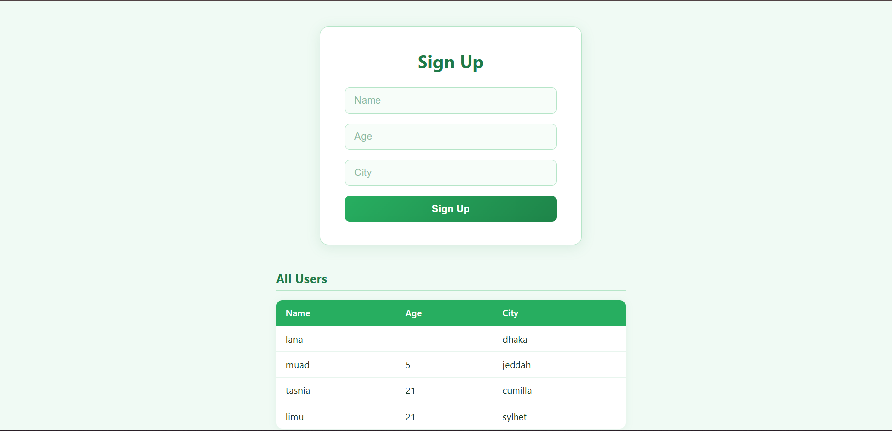

# 📋 MyApp — PHP Sign Up Form

A clean, green-themed PHP web application that allows users to sign up and view a list of registered users. Built with PHP, PDO, MySQL, and vanilla CSS.

---

## 📸 Preview

> A centered sign-up card with **Name**, **Age**, and **City** fields, followed by an **All Users** table showing all registered entries.
> 

---

## 🚀 Features

- ✅ User registration form (Name, Age, City)
- ✅ Server-side form validation
- ✅ SQL Injection protection via **PDO Prepared Statements**
- ✅ Persistent form values on failed submission
- ✅ Success welcome message after sign-up
- ✅ Live users table (newest first)
- ✅ Green & white responsive design

---

## 🛠️ Tech Stack

| Layer      | Technology             |
|------------|------------------------|
| Backend    | PHP 8+                 |
| Database   | MySQL (via XAMPP)      |
| DB Access  | PDO (PHP Data Objects) |
| Frontend   | HTML5 + Vanilla CSS    |
| Server     | Apache (XAMPP)         |

---

## ⚙️ Setup & Installation

### 1. Prerequisites
- [XAMPP](https://www.apachefriends.org/) installed and running
- Apache & MySQL services started

### 2. Clone / Copy the Project
Place the project folder inside your XAMPP `htdocs` directory:
```
C:\xampp\htdocs\myapp\
```

### 3. Create the Database
Open **phpMyAdmin** at `http://localhost/phpmyadmin` and run:

```sql
CREATE DATABASE myapp CHARACTER SET utf8mb4 COLLATE utf8mb4_unicode_ci;

USE myapp;

CREATE TABLE users (
    id   INT AUTO_INCREMENT PRIMARY KEY,
    name VARCHAR(100) NOT NULL,
    age  INT          NULL,
    city VARCHAR(100) NOT NULL
);
```

### 4. Run the App
Open your browser and visit:
```
http://localhost/myapp/signup.php
```

---

## 📁 Project Structure

```
myapp/
├── signup.php      # Main page — form, validation, DB logic & HTML
└── README.md       # Project documentation
```

---

## 🔐 Validation Rules

| Field | Rule                                               |
|-------|----------------------------------------------------|
| Name  | Required — cannot be empty                         |
| Age   | Optional — must be a positive whole number if provided |
| City  | Required — cannot be empty                         |

---

## 🧠 How PDO Works Here

PDO (PHP Data Objects) is used to safely connect and interact with MySQL.

```php
// 1. Connect with error handling
$pdo = new PDO($dsn, 'root', '', [
    PDO::ATTR_ERRMODE            => PDO::ERRMODE_EXCEPTION,
    PDO::ATTR_DEFAULT_FETCH_MODE => PDO::FETCH_ASSOC,
]);

// 2. Safe INSERT using prepared statement (no SQL injection possible)
$stmt = $pdo->prepare('INSERT INTO users(name, age, city) VALUES(:name, :age, :city)');
$stmt->execute(['name' => $name, 'age' => $age, 'city' => $city]);
```

---

## 🐛 Bugs Fixed

| # | Issue                                       | Status    |
|---|---------------------------------------------|-----------|
| 1 | No PDO error mode set                       | ✅ Fixed  |
| 2 | Age field accepted any string               | ✅ Fixed  |
| 3 | Missing ENT_QUOTES/UTF-8 in table output    | ✅ Fixed  |
| 4 | No thead/tbody on users table               | ✅ Fixed  |

---

## 📄 License

This project is open source and free to use for learning purposes.
